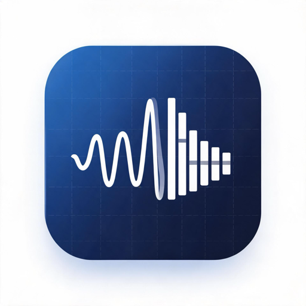
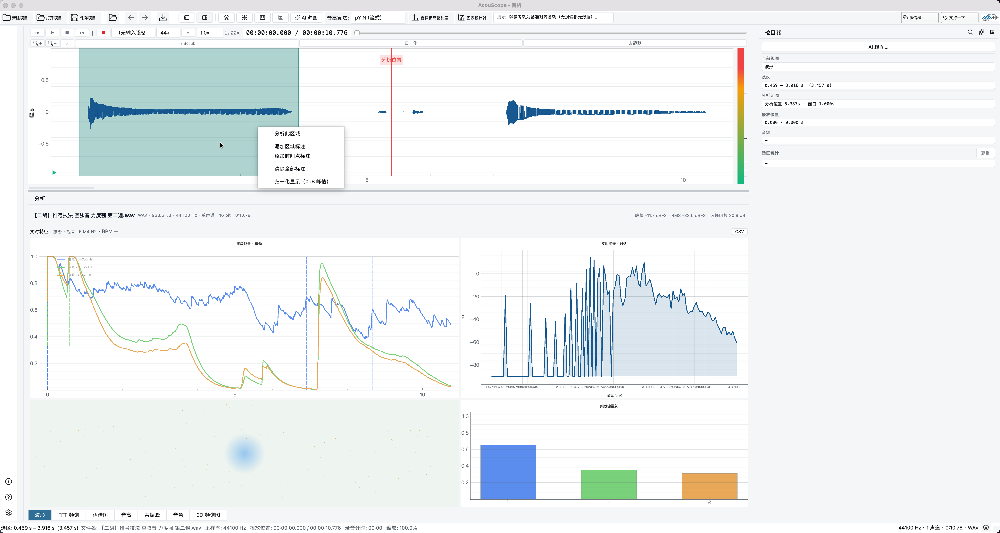

<p align="center">
  
  &nbsp;&nbsp;&nbsp;&nbsp;&nbsp;&nbsp;&nbsp;&nbsp;
  
</p>

<h1 align="center">AcouScope · 音析</h1>

<p align="center"><b>音楽学とデジタル・ヒューマニティーズのための音響分析ソフトウェア</b><br>
音声の読み込みから学術水準の図版出力まで —— 中核となる解析アルゴリズムはすべて純 NumPy で自前実装しています。</p>

<p align="center">
  
  
  
  
</p>

<p align="center">
  <a href="https://acouscope.vercel.app">ウェブサイト</a> ·
  <a href="#インストール">インストール</a> ·
  <a href="#主な機能">主な機能</a> ·
  <a href="#機能モジュール">機能モジュール</a> ·
  <a href="#動作環境">動作環境</a> ·
  <a href="#プロジェクト構成">プロジェクト構成</a> ·
  <a href="#技術スタック">技術スタック</a> ·
  <a href="#ロードマップ">ロードマップ</a> ·
  <a href="#謝辞">謝辞</a> ·
  <a href="#ライセンス">ライセンス</a>
</p>

<p align="center">
  <a href="README.md">English</a> ·
  <a href="README.zh.md">简体中文</a> ·
  <a href="README.zh-TW.md">繁體中文</a> ·
  <a href="README.ko.md">한국어</a> ·
  <b>日本語</b>
</p>

---

<p align="center">
  
</p>

AcouScope（音析）は、音楽学、民族音楽学、音楽心理学、サウンドスケープ研究、楽器音響学のための
クロスプラットフォームなデスクトップ音響分析アプリケーションです。音声の読み込み → 信号解析 →
学術水準の図版出力までを一貫したワークフローで提供します。

FFT / STFT / ピッチ追跡 / フォルマント抽出 / 音色特徴といった中核アルゴリズムは、librosa や scipy
などのサードパーティ製 DSP・科学計算ライブラリに依存せず、すべて NumPy 上に自前で実装しています。
そのため解析チェーンを最後まで検証でき、同じ入力であればどのマシンでも再現できます。

## 主な機能

- **純 NumPy の解析エンジン** —— FFT、STFT、ピッチ追跡、フォルマント、音色指標を自前実装。
  中核の解析経路にサードパーティのアルゴリズムライブラリはありません。
- **出版水準の図版** —— 現在の軸単位・ズーム範囲・マーカーをそのまま反映する WYSIWYG 書き出し。
  SVG / PDF / PNG に対応し、DPI も変更できます。
- **3 言語インターフェース** —— 簡体字中国語・繁体字中国語・英語。すべてのコンテキストメニューと
  ダイアログを網羅します。
- **クロスプラットフォーム** —— Windows、macOS、Linux。
- **テーマシステム** —— OS のライト／ダーク設定に追従し、さらに 9 種類の配色を用意。即時に反映
  されます（チャートキャンバスは常に学術用の白背景を維持）。
- **多次元の周波数軸** —— Hz / kHz / MIDI / ピアノロール / セント / Mel をワンクリックで切替。
  ピアノロールモードでは縦向きのピアノ鍵盤目盛を表示します。

## 機能モジュール

### 時間領域
- 波形とエンベロープの表示、区間測定、正規化
- 前後の無音除去（RMS 適応しきい値。別ファイルとして保存、または元ファイルを変更して自動バックアップ）
- 信号指標：RMS エネルギー、零交差率、ピーク値

### 周波数領域
- FFT スペクトル（窓関数・FFT サイズを調整可能）
- 倍音マーカー：基本音を表示し、最大 6 倍音を自動検出。±100 セントのスナップ付きで手動追加・削除も可能
- ピークホールド、プリセット周波数帯のクイック切替

### 時間周波数
- STFT スペクトログラム（純 NumPy 実装）
- 7 種類のカラーパレット、ダイナミックレンジとコントラストの調整、対数周波数軸
- ピーク追跡曲線、矩形測定ツール
- 3D スペクトログラム（ウォーターフォール表示、14 種類の学術パレット、視点・余白パネルでリアルタイム調整）

### ピッチ
- 基本周波数（F0）の追跡
- A4 基準周波数の調整、基準線の表示切替
- SOTA ディープラーニングバックエンド：RMVPE / SwiftF0（ONNX、オフライン推論）。**RMVPE / SwiftF0 の
  重みは初回使用時に自動ダウンロード**されます（RMVPE ≈ 345MB、SwiftF0 ≈ 390KB、ユーザーデータ
  ディレクトリに保存。詳細は `THIRD-PARTY-NOTICES.md` §3.6）

### フォルマント
- LPC による F1–F4 フォルマント抽出と軌跡表示

### 音色
- MFCC、調波対雑音比（HNR）
- スペクトル重心／帯域幅／減衰／ロールオフ

### リアルタイムと室内音響
- リアルタイム特徴パネル：帯域エネルギーのローリング表示、リアルタイム対数スペクトル、帯域エネルギー
  バー、シーン可視化 —— 4 つのウィンドウが連動します（● LIVE 入力モード、CSV 書き出し）
- 室内モード解析：室内共鳴周波数の計算

### 補助機能
- AI 図版解説：AI が音楽音響学の査読者視点で解析結果を読み解きます（有償機能）
- 音声編集：波形ウィンドウでの区間編集
- 169 件のローテーション Tips（操作のヒントと研究ユーモア）

## インストール

### ソースから実行

```bash
# 方法 1: Poetry
git clone https://github.com/sfk8815-create/AcouScope.git
cd AcouScope/acouscope
poetry install
poetry run acouscope

# 方法 2: pip（仮想環境）
python3.10 -m venv .venv
. .venv/bin/activate          # Windows: .venv\Scripts\activate
pip install -r requirements.txt
PYTHONPATH=src python -m acouscope   # Windows: set PYTHONPATH=src
```

対応形式：WAV / MP3 / FLAC / AIFF など（soundfile 0.12+）。

> **FFmpeg** —— 本リポジトリは ffmpeg バイナリを**同梱していません**（サイズの都合）。
> `.mp3` / `.m4a` などの非可逆形式を再生・書き出しするにはローカルの ffmpeg が必要です：
> `bash scripts/fetch_ffmpeg.sh` を実行するか（macOS arm64 の静的ビルドを取得し sha256 を検証）、
> `brew install ffmpeg` をご利用ください。

### インストーラー

Windows 10 (x64)、macOS 12+ (Intel x86_64)、Linux（Ubuntu AppImage / Arch pacman）向けの
インストーラーはリリースパイプラインにあります。署名と公証を済ませた 4 プラットフォーム版は
v0.99 でリリース予定です（[ロードマップ](#ロードマップ)参照）。それまではソースから実行してください。

### 開発環境

```bash
poetry install --with dev

# 回帰テスト（pytest）
poetry run pytest --ignore tests/test_realtime_panel.py
```

## 動作環境

- Python 3.10+
- PyQt6 + pyqtgraph
- matplotlib
- soundfile（再生は QtMultimedia、pyaudio は任意のフォールバック）

任意の拡張機能（無い場合は自動的にフォールバックし、中核機能には影響しません）：
pyaudio、pydub、samplerate、scipy。

## プロジェクト構成

```
AcouScope/
├── acouscope/                  # アプリケーションのソースツリー
│   ├── src/acouscope/
│   │   ├── ai/                 # AI 図版解説（プロンプト、ライセンス判定）
│   │   ├── analysis/           # 解析サービス（ピッチ、フォルマント、音色、無音検出）
│   │   ├── annotation/         # アノテーション
│   │   ├── app/                # アプリケーション層（コントローラ、プロジェクト、設定）
│   │   ├── audio/              # 音声 I/O（読み書き、再生、録音、編集）
│   │   ├── dsp/                # DSP エンジン（FFT、STFT、窓関数、単位換算）
│   │   ├── i18n/               # 国際化（zh_CN / zh_TW / en_US）
│   │   ├── plugins/            # プラグイン（予約）
│   │   ├── resources/          # リソース（ロゴ、アイコン、同梱ランタイム）
│   │   ├── ui/                 # GUI 層（メインウィンドウ、テーマ、ウィジェット、ダイアログ）
│   │   ├── utils/              # ユーティリティ（設定）
│   │   └── visualization/      # 可視化と図版書き出し
│   ├── tests/                  # 回帰テスト（pytest）
│   ├── scripts/                # ビルドスクリプト
│   └── AcouScope.spec          # PyInstaller ビルド設定
├── scripts/                    # リポジトリ共通の補助スクリプト（例: fetch_ffmpeg.sh）
├── docs/images/                # この README で使用する画像
└── THIRD-PARTY-NOTICES.md
```

## 技術スタック

| 領域 | 技術 |
|------|------|
| 言語 | Python 3.10+ |
| GUI | PyQt6 + pyqtgraph |
| 音響解析 | NumPy（自前実装アルゴリズム） |
| 音声 I/O | soundfile（再生は QtMultimedia、pyaudio は任意） |
| 図版書き出し | matplotlib |
| テスト | pytest / pytest-qt |

## ロードマップ

- **v0.99.20260925（Beta、現行）** —— 9 つの解析エンジン、3 言語インターフェース、テーマシステム、出版水準の書き出し；4 プラットフォームのインストーラー正式配布は準備中 —— 本ベータは意図的にコード署名／公証を行っていません。初回起動で止まった場合は公式サイト「問題が起きたときの対処法」の案内に従ってください
- **v1.0** —— バッチ処理、プラグイン機構、定 Q 変換／ウェーブレット変換、正式リリース

## 謝辞

- [PyQt](https://www.qt.io/qt-for-python) —— Python 向け Qt バインディング
- [pyqtgraph](https://pyqtgraph.readthedocs.io/) —— 高性能なリアルタイム描画
- [matplotlib](https://matplotlib.org/) —— 出版水準の図版
- 同種の音響可視化ソフトウェア —— デザインの着想元

### 特別謝辞

本ソフトウェアを、音楽音響学の第一人者であり中華人民共和国国務院特殊手当の受給者である
**Han Baoqiang（韓寶強）教授**に捧げます。

## ライセンス

**GPL-3.0-only**

本プロジェクトは **PyQt6（GPL-3.0-only）** に依存するため、全体を **GPL-3.0-only** で配布します。
サードパーティ製コンポーネントのライセンスは
[`THIRD-PARTY-NOTICES.md`](THIRD-PARTY-NOTICES.md) にまとめています。

### 著作権と著者

© 西南大学 音楽音響学研究室 · 西南大学 芸術人類学研究所 · 西南大学 中国音楽心理健康研究所

著者：**Fengkai Shi**（石豐愷）—— sfklc@hotmail.com
