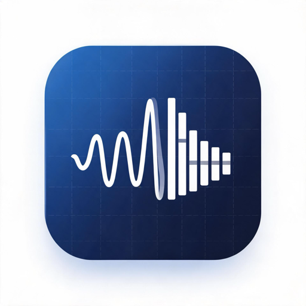
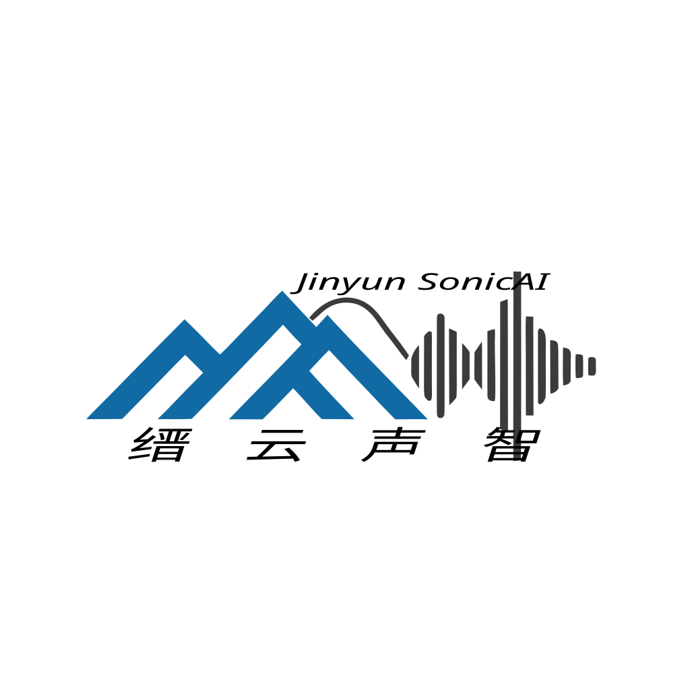
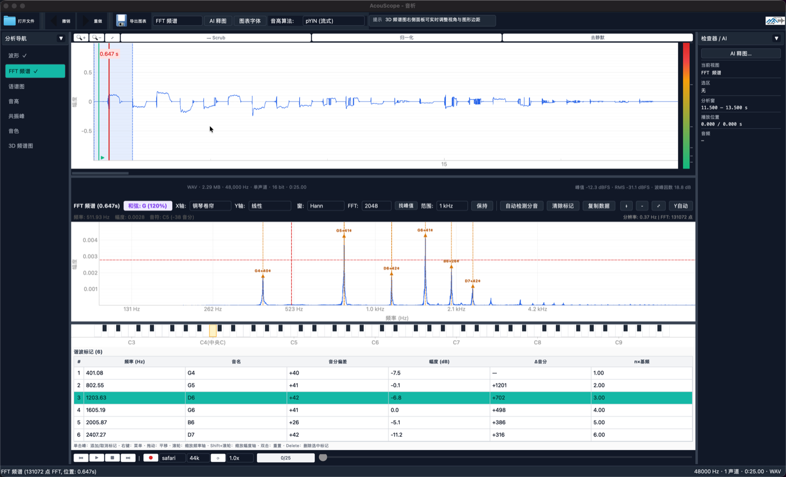

<p align="center">
  
</p>

<p align="center">
  <picture>
    <source media="(prefers-color-scheme: dark)" srcset="docs/images/jinyun-logo-dark.svg" width="190">
    <source media="(prefers-color-scheme: light)" srcset="docs/images/jinyun-logo-light.svg" width="190">
    
  </picture>
</p>

<h1 align="center">AcouScope · 音析</h1>

<p align="center"><b>음악학과 디지털 인문학을 위한 오디오 분석 소프트웨어</b><br>
오디오 가져오기부터 학술급 도표 출력까지 — 모든 핵심 분석 알고리즘을 순수 NumPy로 자체 구현했습니다.</p>

<p align="center">
  
  
  
  
</p>

<p align="center">
  <a href="https://acouscope.vercel.app">웹사이트</a> ·
  <a href="#설치">설치</a> ·
  <a href="#주요-기능">주요 기능</a> ·
  <a href="#기능-모듈">기능 모듈</a> ·
  <a href="#요구-사항">요구 사항</a> ·
  <a href="#프로젝트-구조">프로젝트 구조</a> ·
  <a href="#기술-스택">기술 스택</a> ·
  <a href="#로드맵">로드맵</a> ·
  <a href="#감사의-글">감사의 글</a> ·
  <a href="#라이선스">라이선스</a>
</p>

<p align="center">
  <a href="README.md">English</a> ·
  <a href="README.zh.md">简体中文</a> ·
  <a href="README.zh-TW.md">繁體中文</a> ·
  <b>한국어</b> ·
  <a href="README.ja.md">日本語</a>
</p>

---

<p align="center">
  
</p>

AcouScope(音析)는 음악학, 민족음악학, 음악심리학, 음경(soundscape) 연구와 악기 음향학을 위한
크로스 플랫폼 데스크톱 오디오 분석 애플리케이션입니다. 오디오 가져오기 → 신호 분석 → 학술급 도표
출력까지 하나의 연속된 작업 흐름을 제공합니다.

FFT / STFT / 피치 추적 / 포먼트 추출 / 음색 특징 등 모든 핵심 분석 알고리즘은 librosa나 scipy 같은
서드파티 DSP·과학 연산 라이브러리에 의존하지 않고 NumPy 위에 직접 구현했습니다. 따라서 분석
체인을 끝까지 검토할 수 있고, 동일한 입력에 대해 어떤 머신에서도 재현할 수 있습니다.

## 주요 기능

- **순수 NumPy 분석 엔진** — FFT, STFT, 피치 추적, 포먼트, 음색 지표를 자체 구현했으며, 핵심 분석
  경로에 서드파티 알고리즘 라이브러리가 없습니다.
- **출판 품질 도표** — 현재 축 단위, 확대 범위, 마커를 그대로 반영하는 WYSIWYG 내보내기.
  SVG / PDF / PNG 출력, DPI 조절 가능.
- **3개 언어 인터페이스** — 중국어 간체, 중국어 번체, 영어. 모든 컨텍스트 메뉴와 대화상자를 포함합니다.
- **크로스 플랫폼** — Windows, macOS, Linux.
- **테마 시스템** — 운영체제의 라이트/다크 설정을 따르며 9가지 색상 테마를 추가 제공, 즉시 적용
  (차트 캔버스는 항상 학술용 흰색 배경을 유지).
- **다차원 주파수 축** — Hz / kHz / MIDI / 피아노 롤 / 센트 / Mel 을 한 번의 클릭으로 전환하며,
  피아노 롤 모드에서는 세로 피아노 건반 눈금을 표시합니다.

## 기능 모듈

### 시간 영역
- 파형과 엔벨로프 표시, 구간 측정, 정규화
- 앞뒤 무음 제거(RMS 적응형 임계값, 새 파일로 저장 또는 원본 수정 + 자동 백업)
- 신호 지표: RMS 에너지, 영교차율, 피크값

### 주파수 영역
- FFT 스펙트럼(윈도우 함수와 FFT 크기 조절 가능)
- 배음 마커: 기본음 표시, 최대 6개 부분음 자동 검출, ±100센트 스냅으로 수동 추가/삭제
- 피크 홀드, 프리셋 주파수 대역 간편 전환

### 시간-주파수
- STFT 스펙트로그램(순수 NumPy 구현)
- 7가지 색상 팔레트, 동적 범위와 대비 조절, 로그 주파수 축
- 피크 추적 곡선, 사각형 측정 도구
- 3D 스펙트로그램(폭포수 방식 렌더링, 14가지 학술 팔레트, 시점/여백 파라미터 패널 실시간 조절)

### 피치
- 기본 주파수(F0) 추적
- A4 기준 주파수 조절, 기준선 표시 전환
- SOTA 딥러닝 백엔드: RMVPE / SwiftF0 (ONNX, 오프라인 추론). **RMVPE / SwiftF0 가중치는 최초
  사용 시 자동 다운로드**됩니다(RMVPE ≈ 345MB, SwiftF0 ≈ 390KB, 사용자 데이터 디렉터리에 저장;
  자세한 내용은 `THIRD-PARTY-NOTICES.md` §3.6).

### 포먼트
- LPC 기반 F1–F4 포먼트 추출과 궤적 표시

### 음색
- MFCC 계수, 배음 대 잡음비(HNR)
- 스펙트럼 중심 / 대역폭 / 감쇠 / 롤오프

### 실시간 및 실내 음향
- 실시간 특징 패널: 대역 에너지 롤링 그래프, 실시간 로그 스펙트럼, 대역 에너지 막대, 장면 시각화
  — 네 창이 연동됩니다(● LIVE 입력 모드, CSV 내보내기)
- 실내 모드 분석: 실내 공진 주파수 계산

### 보조 기능
- AI 도표 해석: AI가 음악음향학 심사자 관점에서 분석 결과를 해석합니다(유료 기능)
- 오디오 편집: 파형 창에서 구간 편집
- 169개의 순환 팁(조작 요령 + 연구 유머)

## 설치

### 소스에서 실행

```bash
# 방법 1: Poetry
git clone https://github.com/sfk8815-create/AcouScope.git
cd AcouScope/acouscope
poetry install
poetry run acouscope

# 방법 2: pip(가상 환경)
python3.10 -m venv .venv
. .venv/bin/activate          # Windows: .venv\Scripts\activate
pip install -r requirements.txt
PYTHONPATH=src python -m acouscope   # Windows: set PYTHONPATH=src
```

지원 형식: WAV / MP3 / FLAC / AIFF 등(soundfile 0.12+).

> **FFmpeg** — 이 저장소는 ffmpeg 바이너리를 **포함하지 않습니다**(용량 문제). `.mp3` / `.m4a` 같은
> 비무손실 형식을 재생하거나 내보내려면 로컬 ffmpeg가 필요합니다: `bash scripts/fetch_ffmpeg.sh`
> 를 실행하거나(macOS arm64 정적 빌드를 내려받고 sha256을 검증합니다), `brew install ffmpeg` 를
> 사용하십시오.

### 설치 프로그램

Windows 10 (x64), macOS 12+ (Intel x86_64), Linux(Ubuntu AppImage / Arch pacman)용 설치 프로그램이
릴리스 파이프라인에 있습니다. 서명과 공증이 완료된 네 플랫폼 패키지는 v0.99 릴리스에 예정되어
있습니다([로드맵](#로드맵) 참고). 그때까지는 소스에서 실행해 주십시오.

### 개발 환경

```bash
poetry install --with dev

# 회귀 테스트(pytest)
poetry run pytest --ignore tests/test_realtime_panel.py
```

## 요구 사항

- Python 3.10+
- PyQt6 + pyqtgraph
- matplotlib
- soundfile(재생은 QtMultimedia 사용, pyaudio는 선택적 대체 수단)

선택적 향상 기능(없으면 자동으로 대체 경로를 사용하며 핵심 기능은 영향받지 않습니다):
pyaudio, pydub, samplerate, scipy.

## 프로젝트 구조

```
AcouScope/
├── acouscope/                  # 애플리케이션 소스 트리
│   ├── src/acouscope/
│   │   ├── ai/                 # AI 도표 해석(프롬프트, 라이선스 게이팅)
│   │   ├── analysis/           # 분석 서비스(피치, 포먼트, 음색, 무음 검출)
│   │   ├── annotation/         # 주석
│   │   ├── app/                # 애플리케이션 계층(컨트롤러, 프로젝트, 환경설정)
│   │   ├── audio/              # 오디오 I/O(읽기/쓰기, 재생, 녹음, 편집)
│   │   ├── dsp/                # DSP 엔진(FFT, STFT, 윈도우, 단위 변환)
│   │   ├── i18n/               # 국제화(zh_CN / zh_TW / en_US)
│   │   ├── plugins/            # 플러그인(예약)
│   │   ├── resources/          # 리소스(로고, 아이콘, 내장 런타임)
│   │   ├── ui/                 # GUI 계층(메인 윈도우, 테마, 위젯, 대화상자)
│   │   ├── utils/              # 유틸리티(설정)
│   │   └── visualization/      # 시각화와 도표 내보내기
│   ├── tests/                  # 회귀 테스트(pytest)
│   ├── scripts/                # 빌드 스크립트
│   └── AcouScope.spec          # PyInstaller 빌드 설정
├── scripts/                    # 저장소 수준 보조 스크립트(예: fetch_ffmpeg.sh)
├── docs/images/                # 이 README에서 사용하는 이미지
└── THIRD-PARTY-NOTICES.md
```

## 기술 스택

| 영역 | 기술 |
|------|------|
| 언어 | Python 3.10+ |
| GUI | PyQt6 + pyqtgraph |
| 오디오 분석 | NumPy(자체 구현 알고리즘) |
| 오디오 I/O | soundfile(재생은 QtMultimedia, pyaudio 선택) |
| 도표 내보내기 | matplotlib |
| 테스트 | pytest / pytest-qt |

## 로드맵

- **v0.98 (Beta, 현재)** — 9개 분석 엔진, 3개 언어 인터페이스, 테마 시스템, 출판급 내보내기
- **v0.99** — 네 플랫폼 설치 프로그램 정식 배포, 코드 서명(Windows Authenticode / Apple 공증)
- **v1.0** — 배치 처리, 플러그인 구조, 상수 Q 변환 / 웨이블릿 변환, 정식 릴리스

## 감사의 글

- [PyQt](https://www.qt.io/qt-for-python) — Python용 Qt 바인딩
- [pyqtgraph](https://pyqtgraph.readthedocs.io/) — 고성능 실시간 플로팅
- [matplotlib](https://matplotlib.org/) — 출판 품질 도표
- [Sonic Visualiser](https://www.sonicvisualiser.org/) — 디자인 영감의 원천

### 특별 감사

이 소프트웨어를 음악음향학 분야의 석학이자 중화인민공화국 국무원 특수수당 전문가인
**Han Baoqiang(韓寶強) 교수**님께 바칩니다.

## 라이선스

**GPL-3.0-only**

이 프로젝트는 **PyQt6(GPL-3.0-only)** 에 의존하므로 전체가 **GPL-3.0-only** 로 배포됩니다.
서드파티 구성 요소의 라이선스는 [`THIRD-PARTY-NOTICES.md`](THIRD-PARTY-NOTICES.md)에 정리되어
있습니다.

### 저작권 및 저자

© 서남대학교 음악음향학 실험실 · 서남대학교 예술인류학 연구소 · 서남대학교 중국음악심리건강 연구소

저자: **Fengkai Shi**（石豐愷）— sfklc@hotmail.com
