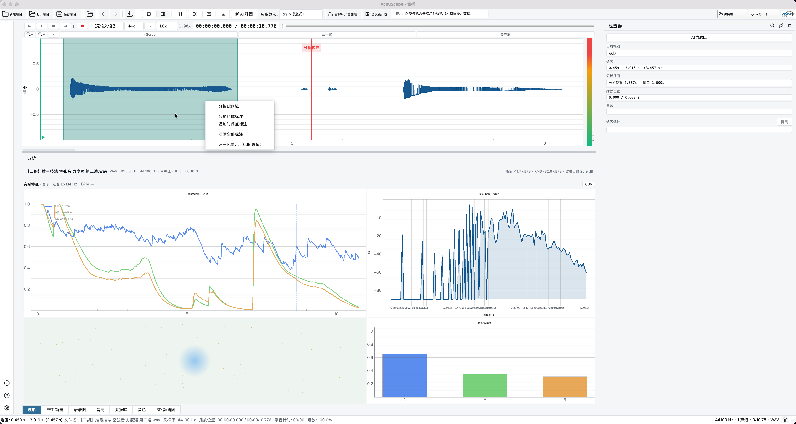

<p align="center">
  
  &nbsp;&nbsp;&nbsp;&nbsp;&nbsp;&nbsp;&nbsp;&nbsp;
  
</p>

<h1 align="center">AcouScope · 音析</h1>

<p align="center"><b>음악학과 디지털 인문학을 위한 음향 분석 소프트웨어</b><br>
오디오 가져오기부터 학술급 도표 출력까지 — 모든 핵심 분석 알고리즘을 순수 NumPy로 자체 구현했습니다.</p>

<p align="center">
  
  
  
  
</p>

<p align="center">
  <a href="https://acouscope.vercel.app">웹사이트</a> ·
  <a href="#설치">설치</a> ·
  <a href="#주요-기능">주요 기능</a> ·
  <a href="#기능-모듈">기능 모듈</a> ·
  <a href="#요구-사항">요구 사항</a> ·
  <a href="#프로젝트-구조">프로젝트 구조</a> ·
  <a href="#기술-스택">기술 스택</a> ·
  <a href="#로드맵">로드맵</a> ·
  <a href="#감사의-글">감사의 글</a> ·
  <a href="#라이선스">라이선스</a>
</p>

<p align="center">
  <a href="README.md">English</a> ·
  <a href="README.zh.md">简体中文</a> ·
  <a href="README.zh-TW.md">繁體中文</a> ·
  <b>한국어</b> ·
  <a href="README.ja.md">日本語</a>
</p>

---

<p align="center">
  
</p>

AcouScope(音析)는 음악학, 민족음악학, 음악심리학, 음경(soundscape) 연구와 악기 음향학을 위한
크로스 플랫폼 데스크톱 음향 분석 애플리케이션입니다. 오디오 가져오기 → 신호 분석 → 학술급 도표
출력까지 하나의 연속된 작업 흐름을 제공합니다.

FFT / STFT / 피치 추적 / 포먼트 추출 / 음색 특징 등 모든 핵심 분석 알고리즘은 librosa나 scipy 같은
서드파티 DSP·과학 연산 라이브러리에 의존하지 않고 NumPy 위에 직접 구현했습니다. 따라서 분석
체인을 끝까지 검토할 수 있고, 동일한 입력에 대해 어떤 머신에서도 재현할 수 있습니다.

## 주요 기능

- **순수 NumPy 분석 엔진** — FFT, STFT, 피치 추적, 포먼트, 음색 지표를 자체 구현했으며, 핵심 분석
  경로에 서드파티 알고리즘 라이브러리가 없습니다.
- **출판 품질 도표** — 현재 축 단위, 확대 범위, 마커를 그대로 반영하는 WYSIWYG 내보내기.
  SVG / PDF / PNG 출력, DPI 조절 가능.
- **3개 언어 인터페이스** — 중국어 간체, 중국어 번체, 영어. 모든 컨텍스트 메뉴와 대화상자를 포함합니다.
- **크로스 플랫폼** — Windows, macOS, Linux.
- **테마 시스템** — 운영체제의 라이트/다크 설정을 따르며 9가지 색상 테마를 추가 제공, 즉시 적용
  (차트 캔버스는 항상 학술용 흰색 배경을 유지).
- **다차원 주파수 축** — Hz / kHz / MIDI / 피아노 롤 / 센트 / Mel 을 한 번의 클릭으로 전환하며,
  피아노 롤 모드에서는 세로 피아노 건반 눈금을 표시합니다.

## 기능 모듈

### 시간 영역
- 파형과 엔벨로프 표시, 구간 측정, 정규화
- 앞뒤 무음 제거(RMS 적응형 임계값, 새 파일로 저장 또는 원본 수정 + 자동 백업)
- 신호 지표: RMS 에너지, 영교차율, 피크값

### 주파수 영역
- FFT 스펙트럼(윈도우 함수와 FFT 크기 조절 가능)
- 배음 마커: 기본음 표시, 최대 6개 부분음 자동 검출, ±100센트 스냅으로 수동 추가/삭제
- 피크 홀드, 프리셋 주파수 대역 간편 전환

### 시간-주파수
- STFT 스펙트로그램(순수 NumPy 구현)
- 7가지 색상 팔레트, 동적 범위와 대비 조절, 로그 주파수 축
- 피크 추적 곡선, 사각형 측정 도구
- 3D 스펙트로그램(폭포수 방식 렌더링, 14가지 학술 팔레트, 시점/여백 파라미터 패널 실시간 조절)

### 피치
- 기본 주파수(F0) 추적
- A4 기준 주파수 조절, 기준선 표시 전환
- SOTA 딥러닝 백엔드: RMVPE / SwiftF0 (ONNX, 오프라인 추론). **RMVPE / SwiftF0 가중치는 최초
  사용 시 자동 다운로드**됩니다(RMVPE ≈ 345MB, SwiftF0 ≈ 390KB, 사용자 데이터 디렉터리에 저장;
  자세한 내용은 `THIRD-PARTY-NOTICES.md` §3.6).

### 포먼트
- LPC 기반 F1–F4 포먼트 추출과 궤적 표시

### 음색
- MFCC 계수, 배음 대 잡음비(HNR)
- 스펙트럼 중심 / 대역폭 / 감쇠 / 롤오프

### 실시간 및 실내 음향
- 실시간 특징 패널: 대역 에너지 롤링 그래프, 실시간 로그 스펙트럼, 대역 에너지 막대, 장면 시각화
  — 네 창이 연동됩니다(● LIVE 입력 모드, CSV 내보내기)
- 실내 모드 분석: 실내 공진 주파수 계산

### 보조 기능
- AI 도표 해석: AI가 음악음향학 심사자 관점에서 분석 결과를 해석합니다(유료 기능)
- 오디오 편집: 파형 창에서 구간 편집
- 169개의 순환 팁(조작 요령 + 연구 유머)

### 논문 그림 내보내기(세 프리셋)

- **진입점** —— 앱에서는 **파일 ▸ 내보내기 ▸ 논문 그림 내보내기…**; 명령줄에서는
  `python -m acouscope.visualization.figures --preset paper_A …` (`--preset` 은
  `paper_A` / `paper_B` / `paper_C` 중 하나).
- **프리셋 ↔ 범용 그래프** —— `paper_A` → `segment_curve`(한 구간의 파형 + 구간 중위값 기준 센트),
  `paper_B` → `type_oscillation`(형태 × 왕복도 패싯), `paper_C` → `reference_comparison`(여러 율제
  참조계 비교).
- **출판 파라미터는 고정** —— **300 dpi PNG + 벡터 PDF**. 크기와 자르기는 추측하지 않습니다.
- **캡션은 사용자가 작성합니다** —— 그림 캡션은 사용자가 쓰며, 플랫폼은 캡션도 결론 문장도 쓰지 않습니다.
- **앵커 오프셋** —— `paper_C` 는 **앵커 오프셋**이 필요합니다(연주 관행이나 문헌에서 제공하며, 플랫폼은
  추측하지 않습니다). 앵커가 없으면 그림을 만들지 않습니다. 실제로 표본으로 삼은 창은
  `window_start_s`(창 격자에 맞춘 실제값)로 반환값에 함께 기록되므로, 창을 바꾸면 수치도 바뀝니다.

### 정밀 교정 내보내기

- **진입점** —— `analysis.calibration_export.calibration_report(...)`; `export_calibration_json()` /
  `export_calibration_csv()` 로 JSON / CSV 로 기록합니다.
- **세 가지 상태는 절대 혼용하지 않습니다** —— `measured`(참조음을 제공해 실제로 측정한 경우),
  `pending`(**참조음을 제공하지 않음 ⇒ 교정 수치를 내지 않음**), `chain_only`(합성 신호는 체인만 검증하며
  교정이라고 부를 수 없음).
- **파라미터 스냅샷과 결합** —— 모든 보고서는 파라미터 스냅샷 `analysis_params_snapshot` 을 담기 때문에,
  교정 수치가 파라미터와 분리되어 인용되지 않습니다.
- **기준 참값이 없으면 주장도 없습니다** —— 기준이 되는 참값(D 밴드 A4 참조음)이 제공되지 않는 한 상태는
  항상 `pending` 이며, 플랫폼은 어떤 정확도 보장 류의 주장도 하지 않습니다.

### 메타데이터 필드 표

- **진입점** —— `annotation.export.profile_field_table()`; `export_profile_field_table_json()` /
  `export_profile_field_table_csv()` 로 기록합니다.
- **네 가지 profile** —— `DAT63` / `GBT31219.4` / `IMDI` / `custom`.
- **기계 검사** —— `check_profile_field_table()` 이 빈 목록을 반환하면 필드 표와 실행 시점 검사가
  일치한다는 뜻입니다.
- **내보내기 계층이 직접 생성하며, 따로 베끼지 않습니다** —— 필드 표는 내보내기 계층이 스스로 만들어 내므로
  표와 내보내기가 갈라질 수 없습니다. 읽는 쪽은 **CSV 머리글 기준으로 열을 가져옵니다**(v2 부터
  `ref_mode` 열 포함).

### 주음 추정: 2단계와 두 기준

- `fit_tonic_from_audio(...)` 의 취수 방식은 고정되어 있습니다: **0–30 s 창**, **HMM 을 거치지 않음**
  (프레임별 f0 를 직접 피팅), **`isfinite(f0)&f0>0` 인 프레임만 취함** —— 0 채움도 보간도 없습니다.
- 앵커 오프셋은 호출자가 제공합니다. **앵커가 없으면** 결합 탐색(`stage="joint"`)으로 돌아가며 그때의
  `margin` 은 흔히 0 입니다. 그런 결과는 **확정된 주음으로 취급할 수 없습니다**.
- `degree_rows_both(model, tuning=..., fit=...)` 는 `absolute` 와 `main_tone` 두 행 집합을 한 번에
  **서로 다른 키로** 돌려줍니다. 두 집합을 하나로 합치는 것은 금지됩니다.

### 腔格 유형 분포·공차 선언·실행 식별자

- **진입점** — `analysis.readout.run_batch(cases, out_dir=...)`; CLI:
  `python -m acouscope.analysis.readout --cases cases.json --out DIR [--figure-out DIR]`.
  네 건의 녹음은 **호출자가 제공**하며, 플랫폼에는 어떤 구체적 녹음도 내장되어
  있지 않습니다.
- **τ 는 플랫폼이 선언** — `analysis.type_distribution.tau_declaration()` 이
  `TAU_CENTS_PLACEHOLDER` 를 읽습니다. 값이 `None` 이면 내보내는 `tau_status` 는
  `unspecified_sign_based`（未标定, 符号判定）입니다. 호출자가 τ 를 주입해
 标定 결과로 위장할 수 없습니다.
- **주사용 τ ≠ 标定 τ** — 掃描件의 `tau_status_by_tau` 는 수치 주사값을
  `assumed_for_scan` 으로 기록하며 `calibrated` 로 적지 않습니다.
- **필드面（件ごと）** — `run_id`／`tau_cents`／`tau_status`／`segment_source`
  （分段器＋파라미터 스냅샷＋창 격자）／`counts_per_recording`
  （上趋／下趋／平直／未分類 ＋ 合計）／`ref_mode`（`absolute`／`main_tone`）、
  그리고 `reference_hz`／`reference_status` 및 `label_gloss`。
- **실행 식별자는 내용 주소 방식** — `run_id` = sha256(입력 목록 × 파라미터面 ×
  분할 스냅샷 × τ／구경面)[:16]。타임스탬프가 아니므로 같은 입력·같은 파라미터로
  다시 실행하면 같은 id 가 재현됩니다 —— 그림과 표가 같은 실행에서 나왔음을
  단정할 수 있는 근거입니다.

- **GUI 진입점** — 「분석 ▸ 배치 판독 실행…」. 대화상자는 매개변수만 모아 spec 을 만들고, 실행은 **작업 센터**에 맡겨 워커 스레드에서 돕니다(창 단위 확정 진행률·협력적 취소). CLI 와 같은 `cases.json` 을 「목록 불러오기…」로 읽으면 동일한 `run_id` 를 재현합니다.


## 설치

### 소스에서 실행

```bash
# 방법 1: Poetry
git clone https://github.com/sfk8815-create/AcouScope.git
cd AcouScope/acouscope
poetry install
poetry run acouscope

# 방법 2: pip(가상 환경)
python3.10 -m venv .venv
. .venv/bin/activate          # Windows: .venv\Scripts\activate
pip install -r requirements.txt
PYTHONPATH=src python -m acouscope   # Windows: set PYTHONPATH=src
```

지원 형식: WAV / MP3 / FLAC / AIFF 등(soundfile 0.12+).

> **FFmpeg** — 이 저장소는 ffmpeg 바이너리를 **포함하지 않습니다**(용량 문제). `.mp3` / `.m4a` 같은
> 비무손실 형식을 재생하거나 내보내려면 로컬 ffmpeg가 필요합니다: `bash scripts/fetch_ffmpeg.sh`
> 를 실행하거나(macOS arm64 정적 빌드를 내려받고 sha256을 검증합니다), `brew install ffmpeg` 를
> 사용하십시오.

### 설치 프로그램

Windows 10 (x64), macOS 12+ (Intel x86_64), Linux(Ubuntu AppImage / Arch pacman)용 설치 프로그램이
릴리스 파이프라인에 있습니다. 서명과 공증이 완료된 네 플랫폼 패키지는 v0.99 릴리스에 예정되어
있습니다([로드맵](#로드맵) 참고). 그때까지는 소스에서 실행해 주십시오.

### 개발 환경

```bash
poetry install --with dev

# 회귀 테스트(pytest)
poetry run pytest --ignore tests/test_realtime_panel.py
```

#### 파일별 테스트 실행

전체 테스트를 한 프로세스로 돌리면 Qt 케이스에서 네이티브 크래시가 발생합니다. 그래서 이 저장소에는
`scripts/run_tests_per_file.sh` 가 포함되어 있습니다: 테스트 파일마다 별도의 pytest 프로세스를 쓰고,
파일별 요약과 수집 개수 대조를 함께 제공합니다.

## 요구 사항

- Python 3.10+
- PyQt6 + pyqtgraph
- matplotlib
- soundfile(재생은 QtMultimedia 사용, pyaudio는 선택적 대체 수단)

선택적 향상 기능(없으면 자동으로 대체 경로를 사용하며 핵심 기능은 영향받지 않습니다):
pyaudio, pydub, samplerate, scipy.

## 프로젝트 구조

```
AcouScope/
├── acouscope/                  # 애플리케이션 소스 트리
│   ├── src/acouscope/
│   │   ├── ai/                 # AI 도표 해석(프롬프트, 라이선스 게이팅)
│   │   ├── analysis/           # 분석 서비스(피치, 포먼트, 음색, 무음 검출)
│   │   ├── annotation/         # 주석
│   │   ├── app/                # 애플리케이션 계층(컨트롤러, 프로젝트, 환경설정)
│   │   ├── audio/              # 오디오 I/O(읽기/쓰기, 재생, 녹음, 편집)
│   │   ├── dsp/                # DSP 엔진(FFT, STFT, 윈도우, 단위 변환)
│   │   ├── i18n/               # 국제화(zh_CN / zh_TW / en_US)
│   │   ├── plugins/            # 플러그인(예약)
│   │   ├── resources/          # 리소스(로고, 아이콘, 내장 런타임)
│   │   ├── ui/                 # GUI 계층(메인 윈도우, 테마, 위젯, 대화상자)
│   │   ├── utils/              # 유틸리티(설정)
│   │   └── visualization/      # 시각화와 도표 내보내기
│   ├── tests/                  # 회귀 테스트(pytest)
│   ├── scripts/                # 빌드 스크립트
│   └── AcouScope.spec          # PyInstaller 빌드 설정
├── scripts/                    # 저장소 수준 보조 스크립트(예: fetch_ffmpeg.sh)
├── docs/images/                # 이 README에서 사용하는 이미지
└── THIRD-PARTY-NOTICES.md
```

## 기술 스택

| 영역 | 기술 |
|------|------|
| 언어 | Python 3.10+ |
| GUI | PyQt6 + pyqtgraph |
| 음향 분석 | NumPy(자체 구현 알고리즘) |
| 오디오 I/O | soundfile(재생은 QtMultimedia, pyaudio 선택) |
| 도표 내보내기 | matplotlib |
| 테스트 | pytest / pytest-qt |

## 로드맵

- **v0.99.20261011 (Beta, 현재)** — 9개 분석 엔진, 인터페이스 완전 지원 언어는 영어·간체·번체(한국어·일본어는 부분 지원, 계속 보충 중), 테마 시스템, 출판급 내보내기; 네 플랫폼 설치 프로그램 정식 배포 완료, 바로 다운로드 가능 — 본 베타는 의도적으로 코드 서명/공증을 생략했습니다. 첫 실행이 막히면 웹사이트의 "문제 발생 시 해결 방법" 안내를 따르세요
- **v1.0** — 배치 처리, 플러그인 구조, 상수 Q 변환 / 웨이블릿 변환, 정식 릴리스

## 감사의 글

- [PyQt](https://www.qt.io/qt-for-python) — Python용 Qt 바인딩
- [pyqtgraph](https://pyqtgraph.readthedocs.io/) — 고성능 실시간 플로팅
- [matplotlib](https://matplotlib.org/) — 출판 품질 도표
- 유사 음향 시각화 소프트웨어 — 디자인 영감의 원천

### 특별 감사

이 소프트웨어를 음악음향학 분야의 석학이자 중화인민공화국 국무원 특수수당 전문가인
**Han Baoqiang(韓寶強) 교수**님께 바칩니다.

## 라이선스

**GPL-3.0-only**

이 프로젝트는 **PyQt6(GPL-3.0-only)** 에 의존하므로 전체가 **GPL-3.0-only** 로 배포됩니다.
서드파티 구성 요소의 라이선스는 [`THIRD-PARTY-NOTICES.md`](THIRD-PARTY-NOTICES.md)에 정리되어
있습니다.

### 저작권 및 저자

© 서남대학교 음악음향학 실험실 · 서남대학교 예술인류학 연구소 · 서남대학교 중국음악심리건강 연구소

저자: **Fengkai Shi**（石豐愷）— sfklc@hotmail.com
