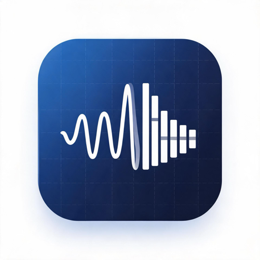
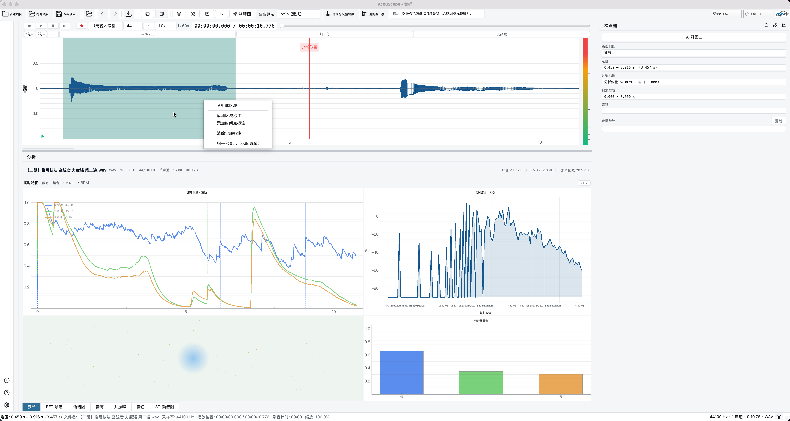

<p align="center">
  
  &nbsp;&nbsp;&nbsp;&nbsp;&nbsp;&nbsp;&nbsp;&nbsp;
  
</p>

<h1 align="center">AcouScope · 音析</h1>

<p align="center"><b>Acoustic analysis for musicology and the digital humanities</b><br>
From import to publication-grade figures — with every core analysis algorithm implemented in pure NumPy.</p>

<p align="center">
  
  
  
  
</p>

<p align="center">
  <a href="https://acouscope.vercel.app">Website</a> ·
  <a href="#install">Install</a> ·
  <a href="#features">Features</a> ·
  <a href="#modules">Modules</a> ·
  <a href="#requirements">Requirements</a> ·
  <a href="#project-structure">Project structure</a> ·
  <a href="#tech-stack">Tech stack</a> ·
  <a href="#roadmap">Roadmap</a> ·
  <a href="#acknowledgments">Acknowledgments</a> ·
  <a href="#license">License</a>
</p>

<p align="center">
  <b>English</b> ·
  <a href="README.zh.md">简体中文</a> ·
  <a href="README.zh-TW.md">繁體中文</a> ·
  <a href="README.ko.md">한국어</a> ·
  <a href="README.ja.md">日本語</a>
</p>

---

<p align="center">
  
</p>

AcouScope (音析) is a cross-platform desktop acoustic analysis application built for research in
musicology, ethnomusicology, music psychology, soundscape studies and musical acoustics. It covers
one continuous workflow: import audio → run signal analysis → export academic-grade figures.

Every core analysis algorithm — FFT / STFT / pitch tracking / formant extraction / timbre features —
is implemented directly on top of NumPy, with no dependency on third-party DSP or scientific
libraries such as librosa or scipy. The analysis chain therefore stays inspectable end to end and
reproducible on any machine given the same input.

## Features

- **Pure-NumPy analysis engines** — FFT, STFT, pitch tracking, formants and timbre descriptors are
  self-implemented; no third-party algorithm libraries in the core analysis path.
- **Publication-grade figures** — WYSIWYG export that follows the current axis units, zoom range and
  markers; SVG / PDF / PNG output with adjustable DPI.
- **Trilingual interface** — Simplified Chinese, Traditional Chinese and English, covering every
  context menu and dialog.
- **Cross-platform** — Windows, macOS and Linux.
- **Theme system** — follows the OS light/dark setting plus 9 complete colour schemes, applied
  immediately (the chart canvas always stays academic white).
- **Multi-dimensional frequency axis** — switch between Hz / kHz / MIDI / piano roll / cents / Mel in
  one click; piano-roll mode draws a vertical piano keyboard ruler.

## Modules

### Time domain
- Waveform and envelope display, selection measurement, normalization
- Silence trimming at both ends (RMS adaptive threshold; save as a new file, or modify in place with
  automatic backup)
- Signal descriptors: RMS energy, zero-crossing rate, peak values

### Frequency domain
- FFT spectrum with adjustable window function and FFT size
- Harmonic markers: marks the fundamental by default, auto-detects the first 6 partials, and supports
  manual add/remove with ±100 cent snapping
- Peak hold, quick switching between preset frequency bands

### Time–frequency
- STFT spectrogram (pure NumPy)
- 7 colour palettes, dynamic range / contrast control, logarithmic frequency axis
- Peak-tracking curve, rectangular measurement tool
- 3D spectrogram (waterfall rendering, 14 academic palettes, live view/margin parameter panel)

### Pitch
- Fundamental frequency (F0) tracking
- Adjustable A4 reference frequency, reference-line toggle
- SOTA deep-learning backends: RMVPE / SwiftF0 (ONNX, offline inference). **The RMVPE / SwiftF0
  weights are downloaded on first use** (RMVPE ≈ 345 MB, SwiftF0 ≈ 390 KB, into the user data
  directory; see `THIRD-PARTY-NOTICES.md` §3.6)

### Formants
- LPC-based F1–F4 formant extraction with trajectory display

### Timbre
- MFCC coefficients, harmonic-to-noise ratio (HNR)
- Spectral centroid / bandwidth / rolloff

### Real-time and room acoustics
- Real-time feature panel: band-energy rolling traces, live log spectrum, band-energy bars, and a
  scene visualisation — four synchronised windows (● LIVE capture mode, CSV export)
- Room mode analysis: room resonance frequency calculation

### Assistive features
- AI chart interpretation: reviews analysis results from a musical-acoustics reviewer's perspective
  (paid feature)
- Audio editing: selection editing in the waveform window
- 169 rotating tips (operation hints plus research humour)

### Publication figure export (presets)

- **Where** — in the application: **File ▸ Export ▸ Export Paper Figure…**; on the command line:
  `python -m acouscope.visualization.figures --preset paper_A …`, where `--preset` takes
  `paper_A` / `paper_B` / `paper_C`.
- **Preset → general figure** — `paper_A` → `segment_curve` (the waveform of one segment plus cents
  relative to the segment median), `paper_B` → `type_oscillation` (type × oscillation-degree facets),
  `paper_C` → `reference_comparison` (comparison across several tuning reference systems).
- **Publication parameters are fixed** — **300 dpi PNG + vector PDF**; nothing about size or cropping
  is guessed.
- **Captions belong to the writer** — figure captions are written by the user; the platform writes
  neither a caption nor a conclusion sentence.
- **Anchoring** — `paper_C` needs an **anchor offset** (supplied from performance practice or the
  literature; the platform does not guess it); with no anchor, no figure is produced. The window
  actually sampled is reported back as `window_start_s` (the real value after alignment to the
  window grid) — change the window and you change the numbers.

### Reference-tone calibration export

- **Entry point** — `analysis.calibration_export.calibration_report(...)`; written out as JSON / CSV by
  `export_calibration_json()` / `export_calibration_csv()`.
- **Three statuses, never conflated** — `measured` (a reference tone was supplied and really
  measured), `pending` (**no reference tone ⇒ no calibration number is produced**), `chain_only`
  (a synthetic signal verifies the chain only; it must not be called a calibration).
- **Bound to the parameters** — every report carries the parameter snapshot
  (`analysis_params_snapshot`), so a calibration number is never quoted away from its parameters.
- **No ground truth, no claim** — as long as the reference ground truth (the D-band A4 reference tone)
  has not been provided, the status stays `pending`, and the platform commits itself to no accuracy
  claim of any kind.

### Metadata field table

- **Entry point** — `annotation.export.profile_field_table()`; written out by
  `export_profile_field_table_json()` / `export_profile_field_table_csv()`.
- **Four profiles** — `DAT63` / `GBT31219.4` / `IMDI` / `custom`.
- **Machine check** — `check_profile_field_table()` returning an empty list means the field table and
  the runtime validation agree.
- **Generated by the export layer, not copied** — the table is produced by the export layer itself
  rather than re-typed from a second mapping, so table and export cannot drift apart; readers take
  columns **by CSV header** (from v2 the table includes the `ref_mode` column).

### Tonic fitting: two stages and two reference modes

- `fit_tonic_from_audio(...)` fixes how the data is taken: a **0–30 s window**, **no HMM** (per-frame
  f0 is fitted directly), and **only frames with `isfinite(f0)&f0>0`** — no zero fill, no
  interpolation.
- The anchor offset comes from the caller. With **no anchor** the fit falls back to a joint search
  (`stage="joint"`) whose `margin` is often 0; such a result is **not** a confirmed main tone.
- `degree_rows_both(model, tuning=..., fit=...)` returns the `absolute` and `main_tone` row sets in one
  call, under **separate keys**; merging the two sets into one list is forbidden.

### Cavity-type distribution, tolerance declaration, and run identity

- **Entrypoint** — `analysis.readout.run_batch(cases, out_dir=...)`; CLI:
  `python -m acouscope.analysis.readout --cases cases.json --out DIR [--figure-out DIR]`.
  The four recordings are supplied **by the caller**; the platform hard-codes none.
- **τ is declared by the platform** — `analysis.type_distribution.tau_declaration()`
  reads `TAU_CENTS_PLACEHOLDER`; while it is `None` the exported `tau_status` is
  `unspecified_sign_based` (uncalibrated, judged by sign). Callers **may not inject**
  a τ and pass it off as calibration.
- **Scan τ ≠ calibrated τ** — sweep artifacts carry `tau_status_by_tau`; numeric scan
  values are recorded `assumed_for_scan`, never `calibrated`.
- **Field surface (per artifact)** — `run_id`, `tau_cents`, `tau_status`,
  `segment_source` (segmenter + parameter snapshot + window grid),
  `counts_per_recording` (上趋／下趋／平直／未分类 ＋ 合计), `ref_mode`
  (`absolute`／`main_tone`), plus `reference_hz`／`reference_status` and `label_gloss`.
- **Run identity is content-addressed** — `run_id` = sha256(input manifest × parameter
  surface × segmentation snapshot × τ／reference-mode surface)[:16]; **not** a timestamp, so
  re-running with the same inputs and parameters reproduces the same id — which is
  what lets one assert that a figure and a table came from the same run.

- **GUI entry** — *Analysis ▸ Batch Readout Run…* collects the parameters into a plain-dict spec; the run itself is submitted to the task center and executed on a worker thread, so the UI never blocks (determinate per-window progress, cooperative cancel). Loading the same `cases.json` the CLI uses reproduces the very same `run_id`.


## Install

### From source

```bash
# Option 1: Poetry
git clone https://github.com/sfk8815-create/AcouScope.git
cd AcouScope/acouscope
poetry install
poetry run acouscope

# Option 2: pip (virtual environment)
python3.10 -m venv .venv
. .venv/bin/activate          # Windows: .venv\Scripts\activate
pip install -r requirements.txt
PYTHONPATH=src python -m acouscope   # Windows: set PYTHONPATH=src
```

Supported formats: WAV / MP3 / FLAC / AIFF and more (via soundfile 0.12+).

> **FFmpeg** — this repository does **not** bundle an ffmpeg binary (size reasons). Playing or
> exporting non-lossless formats such as `.mp3` / `.m4a` requires a local ffmpeg: run
> `bash scripts/fetch_ffmpeg.sh` (downloads the macOS arm64 static build with a sha256 check), or
> install it with `brew install ffmpeg`.

### Installers

Prebuilt installers for Windows 10 (x64), macOS 12+ (Intel x86_64) and Linux (Ubuntu AppImage /
Arch pacman) exist in the release pipeline. Signed, notarised packages for all four targets are
scheduled for the v0.99 release (see [Roadmap](#roadmap)); until then please run from source.

### Development

```bash
poetry install --with dev

# Regression suite (pytest)
poetry run pytest --ignore tests/test_realtime_panel.py
```

#### Running tests per file

A single-process run of the whole suite crashes natively at the Qt cases, so the repository ships
`scripts/run_tests_per_file.sh`: one pytest process per test file, with a per-file summary and a
reconciliation against the directory collection count.

## Requirements

- Python 3.10+
- PyQt6 + pyqtgraph
- matplotlib
- soundfile (playback through QtMultimedia; pyaudio is an optional fallback)

Optional enhancements, with automatic fallback when absent — the core functionality is unaffected:
pyaudio, pydub, samplerate, scipy.

## Project structure

```
AcouScope/
├── acouscope/                  # Application source tree
│   ├── src/acouscope/
│   │   ├── ai/                 # AI chart interpretation (prompts, licence gating)
│   │   ├── analysis/           # Analysis services (pitch, formants, timbre, silence detection)
│   │   ├── annotation/         # Annotation
│   │   ├── app/                # Application layer (controller, project, preferences)
│   │   ├── audio/              # Audio I/O (read/write, playback, recording, editing)
│   │   ├── dsp/                # DSP engine (FFT, STFT, windows, unit conversion)
│   │   ├── i18n/               # Internationalisation (zh_CN / zh_TW / en_US)
│   │   ├── plugins/            # Plugins (reserved)
│   │   ├── resources/          # Resources (logo, icons, bundled runtimes)
│   │   ├── ui/                 # GUI layer (main window, theme, widgets, dialogs)
│   │   ├── utils/              # Utilities (configuration)
│   │   └── visualization/      # Visualisation and figure export
│   ├── tests/                  # Regression suite (pytest)
│   ├── scripts/                # Build scripts
│   └── AcouScope.spec          # PyInstaller build configuration
├── scripts/                    # Repository-level helper scripts (e.g. fetch_ffmpeg.sh)
├── docs/images/                # Images used by this README
└── THIRD-PARTY-NOTICES.md
```

## Tech stack

| Area | Technology |
|------|------------|
| Language | Python 3.10+ |
| GUI | PyQt6 + pyqtgraph |
| Acoustic analysis | NumPy (self-implemented algorithms) |
| Audio I/O | soundfile (playback via QtMultimedia, pyaudio optional) |
| Figure export | matplotlib |
| Tests | pytest / pytest-qt |

## Roadmap

- **v0.99.20261011 (Beta, current)** — nine analysis engines, interface fully localized in English, Simplified and Traditional Chinese (Korean and Japanese partially covered, being completed), theme system,
  publication-grade export; installers for four targets are already released and downloadable — this beta
  ships **unsigned by design**: see the website's "What to do if something goes wrong" for first-launch guidance
- **v1.0** — batch processing, plugin mechanism, constant-Q transform / wavelet transform, general
  availability

## Acknowledgments

- [PyQt](https://www.qt.io/qt-for-python) — Python bindings for Qt
- [pyqtgraph](https://pyqtgraph.readthedocs.io/) — high-performance real-time plotting
- [matplotlib](https://matplotlib.org/) — publication-grade figures
- Similar acoustic-visualisation tools — design inspiration

### Special thanks

This software is dedicated to **Professor Han Baoqiang** — a leading scholar in musical acoustics
and a recipient of the Special Government Allowance of the State Council of the People's Republic of
China.

## License

**GPL-3.0-only**

AcouScope depends on **PyQt6 (GPL-3.0-only)** and is therefore distributed as a whole under
**GPL-3.0-only**. Licences of the third-party components are listed in
[`THIRD-PARTY-NOTICES.md`](THIRD-PARTY-NOTICES.md).

### Copyright and authorship

© Music Acoustics Laboratory, Southwest University · Institute of Artistic Anthropology, Southwest
University · Institute of Chinese Music and Mental Health, Southwest University

Author: **Fengkai Shi** — sfklc@hotmail.com
