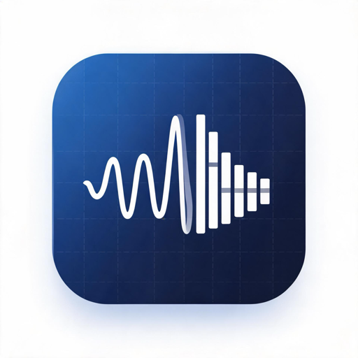
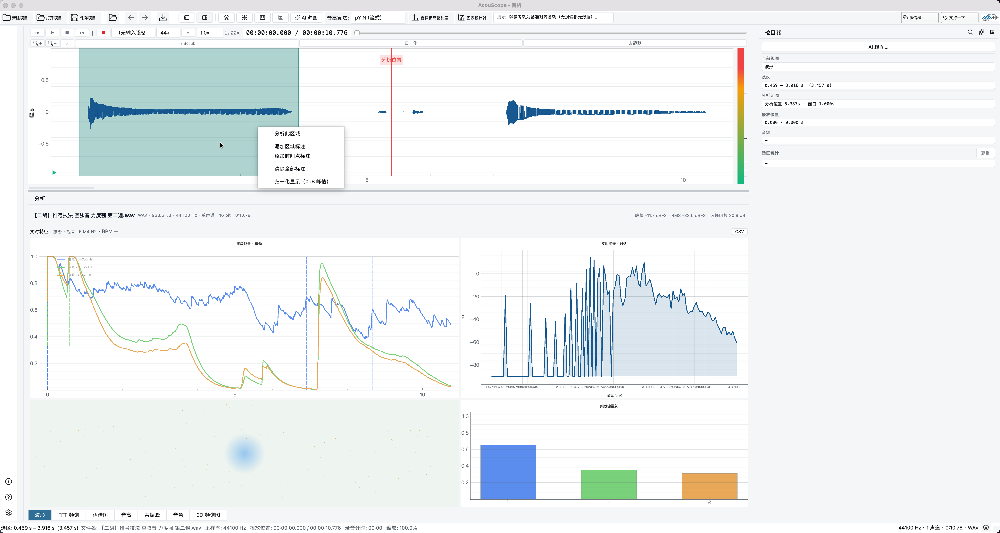

<p align="center">
  
  &nbsp;&nbsp;&nbsp;&nbsp;&nbsp;&nbsp;&nbsp;&nbsp;
  
</p>

<h1 align="center">AcouScope · 音析</h1>

<p align="center"><b>面向音樂學與數位人文的聲學分析軟體</b><br>
從音訊匯入到學術級出圖 —— 全部核心分析演算法以純 NumPy 自主實作。</p>

<p align="center">
  
  
  
  
</p>

<p align="center">
  <a href="https://acouscope.vercel.app">官方網站</a> ·
  <a href="#安裝">安裝</a> ·
  <a href="#核心特性">核心特性</a> ·
  <a href="#功能模組">功能模組</a> ·
  <a href="#環境需求">環境需求</a> ·
  <a href="#專案結構">專案結構</a> ·
  <a href="#技術棧">技術棧</a> ·
  <a href="#路線圖">路線圖</a> ·
  <a href="#致謝">致謝</a> ·
  <a href="#授權條款">授權條款</a>
</p>

<p align="center">
  <a href="README.md">English</a> ·
  <a href="README.zh.md">简体中文</a> ·
  <b>繁體中文</b> ·
  <a href="README.ko.md">한국어</a> ·
  <a href="README.ja.md">日本語</a>
</p>

---

<p align="center">
  
</p>

AcouScope（音析）是一款跨平台桌面聲學分析軟體，面向音樂學、民族音樂學、音樂心理學、聲景研究與
樂器聲學等研究場景。它涵蓋一條連續的工作流程：音訊匯入 → 訊號分析 → 學術級出圖。

全部核心分析演算法 —— FFT / STFT / 音高追蹤 / 共振峰擷取 / 音色特徵 —— 均直接基於 NumPy 自主
實作，不依賴 librosa、scipy 等第三方科學運算函式庫。分析鏈因此可逐行檢視，並在相同輸入的任意
機器上可重現。

## 核心特性

- **純 NumPy 自研演算法**：FFT / STFT / 音高追蹤 / 共振峰 / 音色特徵等核心分析引擎全部自主實作，
  核心分析鏈無第三方演算法函式庫依賴。
- **出版級出圖**：圖表所見即所得匯出（跟隨當前軸單位、縮放範圍與標記），支援 SVG / PDF / PNG
  等格式，DPI 可調。
- **三語介面**：簡體中文 / 繁體中文 / English 全量涵蓋（含所有右鍵選單與對話框）。
- **跨平台**：Windows、macOS、Linux。
- **主題系統**：跟隨系統深淺色 + 9 套完整配色，切換即時生效（圖表畫布保持學術白底）。
- **多維頻率軸**：Hz / kHz / MIDI / 鋼琴捲簾 / 音分 / Mel 一鍵切換，鋼琴捲簾模式顯示直排
  鋼琴鍵盤標尺。

## 功能模組

### 時域分析
- 波形與包絡顯示、選區量測、正規化
- 去除開頭／結尾靜音（RMS 自適應閾值；支援另存新檔，或修改來源檔並自動備份）
- 訊號特徵：RMS 能量、過零率、峰值

### 頻域分析
- FFT 頻譜（窗函式 / FFT 大小可調）
- 諧波標記：預設標記基頻，自動偵測前 6 個分音；支援手動增刪（±100 音分吸附）
- 峰值保持、預設頻段快捷切換

### 時頻分析
- STFT 頻譜圖（純 NumPy 實作）
- 7 組色盤、動態範圍 / 對比度調節、對數頻率軸
- 峰值追蹤曲線、矩形量測工具
- 3D 頻譜圖（瀑布式三維算繪，14 組學術色盤，視角 / 邊距參數面板即時調節）

### 音高分析
- 基頻（F0）追蹤
- A4 參考頻率可調、參考線開關
- SOTA 深度後端：RMVPE / SwiftF0（ONNX，離線推論）。**首次使用 RMVPE / SwiftF0 會按需下載權重**
  （RMVPE ≈ 345MB，SwiftF0 ≈ 390KB，下載至使用者資料目錄；詳見 `THIRD-PARTY-NOTICES.md` §3.6）

### 共振峰分析
- LPC 法 F1–F4 共振峰擷取與軌跡顯示

### 音色特徵
- MFCC 係數、諧波雜訊比（HNR）
- 頻譜質心 / 頻寬 / 衰減 / 滾降

### 即時與室內聲學
- 即時特徵面板：頻段能量滾動線、即時對數頻譜、頻段能量條、場景視覺化 —— 四視窗聯動
  （● LIVE 錄入模式，CSV 匯出）
- 室內模態分析：室內共振頻率計算

### 輔助能力
- AI 釋圖：AI 以音樂聲學審稿人視角解讀分析結果（付費功能）
- 音訊編輯：波形視窗選區編輯
- 169 條輪換提示（操作技巧 + 研究幽默）

### 論文圖匯出（三預設）

- **入口** —— 軟體內：**檔案 ▸ 匯出 ▸ 論文圖匯出…**；命令列：
  `python -m acouscope.visualization.figures --preset paper_A …`，`--preset` 取 `paper_A`／`paper_B`／`paper_C`。
- **預設 ↔ 通用圖形** —— `paper_A` → `segment_curve`（一段的波形＋相對段中位音分）、
  `paper_B` → `type_oscillation`（形態 × 往復度分面）、`paper_C` → `reference_comparison`（多律制參照系對比）。
- **出版參數固定** —— **300 dpi PNG ＋ 向量 PDF**；尺寸與裁切不靠猜。
- **圖註歸使用者** —— 圖註由使用者撰寫；平台不寫圖註、不下結論句。
- **錨定偏移** —— `paper_C` 需要**錨定偏移**（由演奏實踐／文獻給定，平台不猜）；缺錨不出圖。實際取數窗
  隨回傳值登記為 `window_start_s`（按窗格對齊後的實際值），換窗即換數。

### 精度標定匯出

- **介面** —— `analysis.calibration_export.calibration_report(...)`；由 `export_calibration_json()`／
  `export_calibration_csv()` 落盤 JSON／CSV。
- **三檔狀態，不得混稱** —— `measured`（已提供參考音、實測實算）、`pending`（**未提供參考音 ⇒ 不出標定數**）、
  `chain_only`（合成訊號只驗鏈路，不得稱為標定）。
- **與參數快照綁定** —— 每份報告都攜帶參數快照 `analysis_params_snapshot`，標定數不脫離參數單獨引用。
- **無真值即無宣稱** —— 參考真值（D 檔 A4 參考音）未提供時狀態恆為 `pending`，平台不作任何精度保證類宣稱。

### 中繼資料欄位表

- **介面** —— `annotation.export.profile_field_table()`；由 `export_profile_field_table_json()`／
  `export_profile_field_table_csv()` 落盤。
- **四種 profile** —— `DAT63`／`GBT31219.4`／`IMDI`／`custom`。
- **機檢** —— `check_profile_field_table()` 回傳空清單，表示欄位表與執行期校驗一致。
- **由匯出層自身產生，不是另抄** —— 欄位表由匯出層自己產出，不是另抄一份對應表，表與匯出不會分叉；讀取方
  **按 CSV 表頭取欄**（v2 起含 `ref_mode` 欄）。

### 主音兩階段與雙口徑

- `fit_tonic_from_audio(...)` 的取數口徑固定：**0–30 s 窗**、**不過 HMM**（逐幀 f0 直接擬合）、
  **只取 `isfinite(f0)&f0>0` 的幀**，不補零、不插值。
- 錨定偏移由呼叫方給定；**無錨**時退回聯合搜尋（`stage="joint"`），其 `margin` 常為 0，**不得當作已確認主音**。
- `degree_rows_both(model, tuning=..., fit=...)` 一次取回 `absolute` 與 `main_tone` 兩套行，**分鍵回傳**；
  把兩套行合併成一個清單是禁止的。

### 腔格類型分佈、容差宣告與執行識別

- **入口** —— `analysis.readout.run_batch(cases, out_dir=...)`；命令列：
  `python -m acouscope.analysis.readout --cases cases.json --out DIR [--figure-out DIR]`。
  四例由**呼叫方**提供，平台不內建任何具體錄音。
- **τ 由平台宣告** —— `analysis.type_distribution.tau_declaration()` 讀
  `TAU_CENTS_PLACEHOLDER`；值為 `None` 時匯出件的 `tau_status` 為
  `unspecified_sign_based`（未標定，按符號判）。使用者**不得**注入 τ 冒充標定結果。
- **掃描 τ ≠ 標定 τ** —— 掃描件帶 `tau_status_by_tau`；數值掃描檔一律記
  `assumed_for_scan`，絕不記 `calibrated`。
- **欄位面（每件）** —— `run_id`／`tau_cents`／`tau_status`／`segment_source`
  （分段器＋參數快照＋窗格）／`counts_per_recording`（上趋／下趋／平直／未分類 ＋ 合計）／
  `ref_mode`（`absolute`／`main_tone`），另含 `reference_hz`／`reference_status`
  與 `label_gloss`。
- **執行識別採內容定址** —— `run_id` = sha256（輸入清單 × 參數面 × 分段快照
  × τ／口徑面）[:16]，**非時間戳**：同輸入同參重跑得同一 id，故可據此斷言圖件與表件同源。

- **GUI 入口** ——「分析 ▸ 批次讀數執行…」。對話框只採集參數產出 spec，跑批投遞到**任務中心**在 worker 執行緒執行，主執行緒不阻塞（依窗給確定式進度、可協作式取消）；用「載入清單…」讀入與命令列同一份 `cases.json`，即可重現同一個 `run_id`。


## 安裝

### 從原始碼執行

```bash
# 方式一：Poetry
git clone https://github.com/sfk8815-create/AcouScope.git
cd AcouScope/acouscope
poetry install
poetry run acouscope

# 方式二：pip（虛擬環境）
python3.10 -m venv .venv
. .venv/bin/activate          # Windows: .venv\Scripts\activate
pip install -r requirements.txt
PYTHONPATH=src python -m acouscope   # Windows: set PYTHONPATH=src
```

支援格式：WAV / MP3 / FLAC / AIFF 等（soundfile 0.12+）。

> **FFmpeg** —— 本倉庫**不內建** ffmpeg 二進位檔（體積考量）。播放或匯出 `.mp3` / `.m4a` 等
> 非無損格式需要本機 ffmpeg：執行 `bash scripts/fetch_ffmpeg.sh`（下載 macOS arm64 靜態版並做
> sha256 校驗），或 `brew install ffmpeg`。

### 安裝套件

Windows 10 (x64)、macOS 12+ (Intel x86_64)、Linux（Ubuntu AppImage / Arch pacman）的安裝套件已在
發布流程中；**四平台簽章與公證版本**安排在 v0.99 發行（見 [路線圖](#路線圖)）。在此之前請從原始碼執行。

### 開發環境

```bash
poetry install --with dev

# 回歸測試（pytest）
poetry run pytest --ignore tests/test_realtime_panel.py
```

#### 逐檔案跑測試

單一行程跑全量測試會在 Qt 用例處原生崩潰，故本倉庫自帶 `scripts/run_tests_per_file.sh`：每個測試檔案一個
獨立 pytest 行程，並給出逐檔案彙總與收集數對帳。

## 環境需求

- Python 3.10+
- PyQt6 + pyqtgraph
- matplotlib
- soundfile（播放經 QtMultimedia，pyaudio 為可選後備）

可選增強（缺少時自動回退，核心功能不受影響）：pyaudio、pydub、samplerate、scipy。

## 專案結構

```
AcouScope/
├── acouscope/                  # 應用程式原始碼樹
│   ├── src/acouscope/
│   │   ├── ai/                 # AI 釋圖（提示詞、授權閘控）
│   │   ├── analysis/           # 分析服務（音高、共振峰、音色、靜音偵測等）
│   │   ├── annotation/         # 標註
│   │   ├── app/                # 應用層（控制器、專案、偏好）
│   │   ├── audio/              # 音訊 I/O（讀寫、播放、錄音、編輯）
│   │   ├── dsp/                # DSP 引擎（FFT、STFT、窗函式、單位換算）
│   │   ├── i18n/               # 國際化（zh_CN / zh_TW / en_US）
│   │   ├── plugins/            # 外掛（預留）
│   │   ├── resources/          # 資源檔（LOGO、圖示、內建執行環境）
│   │   ├── ui/                 # GUI 層（主視窗、主題、控制項、對話框）
│   │   ├── utils/              # 工具函式（設定）
│   │   └── visualization/      # 視覺化與出圖
│   ├── tests/                  # 回歸測試（pytest）
│   ├── scripts/                # 建置腳本
│   └── AcouScope.spec          # PyInstaller 打包設定
├── scripts/                    # 倉庫層級輔助腳本（如 fetch_ffmpeg.sh）
├── docs/images/                # 本 README 使用的圖片
└── THIRD-PARTY-NOTICES.md
```

## 技術棧

| 類別 | 技術 |
|------|------|
| 語言 | Python 3.10+ |
| GUI | PyQt6 + pyqtgraph |
| 聲學分析 | NumPy（純自研演算法） |
| 音訊 I/O | soundfile（播放經 QtMultimedia，pyaudio 為可選後備） |
| 出版級出圖 | matplotlib |
| 測試 | pytest / pytest-qt |

## 路線圖

- **v0.99.20261011（Beta，當前）** —— 九大分析引擎 + 介面完整支援英文、簡體中文、繁體中文（韓語、日語為部分覆蓋，正在補齊）+ 主題系統 + 出版級匯出；四平台安裝套件已正式發行、可直接下載 —— 本內測版**有意未做程式碼簽章/公證**，首啟遇阻請依官網「遇到問題怎麼辦」指引操作
- **v1.0** —— 批次處理、外掛機制、常 Q 變換 / 小波變換，正式發布

## 致謝

- [PyQt](https://www.qt.io/qt-for-python) —— Python Qt 綁定
- [pyqtgraph](https://pyqtgraph.readthedocs.io/) —— 高效能即時繪圖
- [matplotlib](https://matplotlib.org/) —— 出版級出圖
- 同類聲學視覺化軟體 —— 設計靈感來源

### 特別鳴謝

謹以此軟體特別鳴謝並獻予**韓寶強教授**——音樂聲學領軍學者，中華人民共和國國務院特殊津貼專家。

## 授權條款

**GPL-3.0-only**

本專案因依賴 **PyQt6（GPL-3.0-only）**，整體以 **GPL-3.0-only** 散布。第三方元件授權條款見
[`THIRD-PARTY-NOTICES.md`](THIRD-PARTY-NOTICES.md)。

### 版權與作者

© 西南大學·音樂聲學實驗室 · 西南大學·藝術人類學研究所 · 西南大學·中國音樂心理健康研究所

作者：**石豐愷**（Fengkai Shi）—— sfklc@hotmail.com
