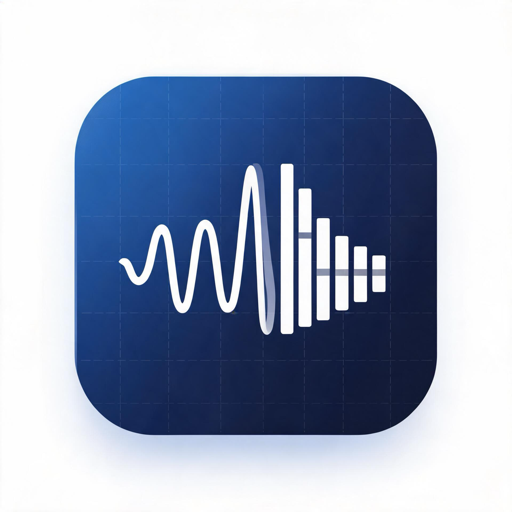
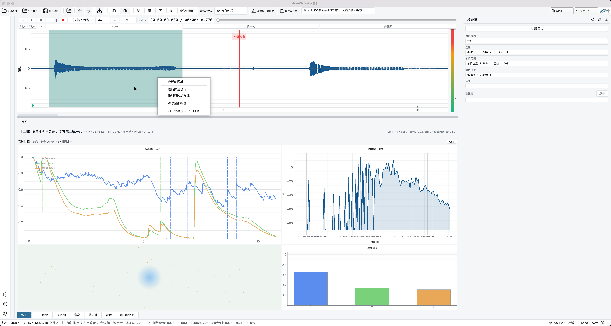

<p align="center">
  
  &nbsp;&nbsp;&nbsp;&nbsp;&nbsp;&nbsp;&nbsp;&nbsp;
  
</p>

<h1 align="center">AcouScope · 音析</h1>

<p align="center"><b>面向音乐学与数字人文的声学分析软件</b><br>
从音频导入到学术级出图 —— 全部核心分析算法以纯 NumPy 自主实现。</p>

<p align="center">
  
  
  
  
</p>

<p align="center">
  <a href="https://acouscope.vercel.app">官网</a> ·
  <a href="#安装">安装</a> ·
  <a href="#核心特性">核心特性</a> ·
  <a href="#功能模块">功能模块</a> ·
  <a href="#环境要求">环境要求</a> ·
  <a href="#项目结构">项目结构</a> ·
  <a href="#技术栈">技术栈</a> ·
  <a href="#路线图">路线图</a> ·
  <a href="#致谢">致谢</a> ·
  <a href="#许可证">许可证</a>
</p>

<p align="center">
  <a href="README.md">English</a> ·
  <b>简体中文</b> ·
  <a href="README.zh-TW.md">繁體中文</a> ·
  <a href="README.ko.md">한국어</a> ·
  <a href="README.ja.md">日本語</a>
</p>

---

<p align="center">
  
</p>

AcouScope（音析）是一款跨平台桌面声学分析软件，面向音乐学、民族音乐学、音乐心理学、声景研究与
乐器声学等研究场景。它覆盖一条连续的工作流：音频导入 → 信号分析 → 学术级出图。

全部核心分析算法 —— FFT / STFT / 音高追踪 / 共振峰提取 / 音色特征 —— 均直接基于 NumPy 自主实现，
不依赖 librosa、scipy 等第三方科学计算库。分析链路因此可逐行审视，并在相同输入的任意机器上
可复现。

## 核心特性

- **纯 NumPy 自研算法**：FFT / STFT / 音高追踪 / 共振峰 / 音色特征等核心分析引擎全部自主实现，
  核心分析链路无第三方算法库依赖。
- **出版级出图**：图表所见即所得导出（跟随当前轴单位、缩放范围与标记），支持 SVG / PDF / PNG
  等格式，DPI 可调。
- **三语界面**：简体中文 / 繁体中文 / English 全量覆盖（含所有右键菜单与对话框）。
- **跨平台**：Windows、macOS、Linux。
- **主题系统**：跟随系统深浅色 + 9 套完整配色，切换即时生效（图表画布保持学术白底）。
- **多维频率轴**：Hz / kHz / MIDI / 钢琴卷帘 / 音分 / Mel 一键切换，钢琴卷帘模式显示竖排
  钢琴键盘标尺。

## 功能模块

### 时域分析
- 波形与包络显示、选区测量、归一化
- 去除开头/结尾静默（RMS 自适应阈值；支持另存新文件，或修改源文件并自动备份）
- 信号特征：RMS 能量、过零率、峰值

### 频域分析
- FFT 频谱（窗函数 / FFT 大小可调）
- 谐波标记：默认标记基频，自动检测前 6 个分音；支持手动增删（±100 音分吸附）
- 峰值保持、预设频段快捷切换

### 时频分析
- STFT 语谱图（纯 NumPy 实现）
- 7 组色板、动态范围 / 对比度调节、对数频率轴
- 峰值追踪曲线、矩形测量工具
- 3D 频谱图（瀑布式三维渲染，14 组学术色板，视角 / 边距参数面板实时调节）

### 音高分析
- 基频（F0）追踪
- A4 参考频率可调、参考线开关
- SOTA 深度后端：RMVPE / SwiftF0（ONNX，离线推理）。**首次使用 RMVPE / SwiftF0 会按需下载权重**
  （RMVPE ≈ 345MB，SwiftF0 ≈ 390KB，下载到用户数据目录；详见 `THIRD-PARTY-NOTICES.md` §3.6）

### 共振峰分析
- LPC 法 F1–F4 共振峰提取与轨迹显示

### 音色特征
- MFCC 系数、谐波噪声比（HNR）
- 频谱质心 / 带宽 / 衰减 / 滚降

### 实时与房间声学
- 实时特征面板：频段能量滚动线、实时对数频谱、频段能量条、场景可视化 —— 四窗口联动
  （● LIVE 录入模式，CSV 导出）
- 房间模态分析：房间共振频率计算

### 辅助能力
- AI 释图：AI 以音乐声学审稿人视角解读分析结果（付费功能）
- 音频编辑：波形窗口选区编辑
- 169 条轮换提示（操作技巧 + 科研幽默）

### 论文图导出（三预设）

- **入口** —— 软件内：**文件 ▸ 导出 ▸ 论文图导出…**；命令行：
  `python -m acouscope.visualization.figures --preset paper_A …`，`--preset` 取 `paper_A`／`paper_B`／`paper_C`。
- **预设 ↔ 通用图形** —— `paper_A` → `segment_curve`（一段的波形＋相对段中位音分）、
  `paper_B` → `type_oscillation`（形态 × 往复度分面）、`paper_C` → `reference_comparison`（多律制参照系对比）。
- **出版参数固定** —— **300 dpi PNG ＋ 矢量 PDF**；尺寸与裁剪不靠猜。
- **图注归使用者** —— 图注由使用者撰写；平台不写图注、不下结论句。
- **锚定偏移** —— `paper_C` 需要**锚定偏移**（由演奏实践／文献给定，平台不猜）；缺锚不出图。实际取数窗
  随返回值登记为 `window_start_s`（按窗格对齐后的实际值），换窗即换数。

### 精度标定导出

- **接口** —— `analysis.calibration_export.calibration_report(...)`；由 `export_calibration_json()`／
  `export_calibration_csv()` 落盘 JSON／CSV。
- **三档状态，不得混称** —— `measured`（已提供参考音、真测真算）、`pending`（**未提供参考音 ⇒ 不出标定数**）、
  `chain_only`（合成信号只验链路，不得称为标定）。
- **与参数快照绑定** —— 每份报告都携带参数快照 `analysis_params_snapshot`，标定数不脱离参数单独引用。
- **无真值即无宣称** —— 参考真值（D 档 A4 参考音）未提供时状态恒为 `pending`，平台不作任何精度保证类宣称。

### 元数据字段表

- **接口** —— `annotation.export.profile_field_table()`；由 `export_profile_field_table_json()`／
  `export_profile_field_table_csv()` 落盘。
- **四 profile** —— `DAT63`／`GBT31219.4`／`IMDI`／`custom`。
- **机检** —— `check_profile_field_table()` 返回空列表，表示字段表与运行时校验一致。
- **由导出层自身生成，不是另抄** —— 字段表由导出层自己产出，不是另抄一份映射，表与导出不会分叉；读取方
  **按 CSV 表头取列**（v2 起含 `ref_mode` 列）。

### 主音两阶段与双口径

- `fit_tonic_from_audio(...)` 的取数口径固定：**0–30 s 窗**、**不过 HMM**（逐帧 f0 直接拟合）、
  **只取 `isfinite(f0)&f0>0` 的帧**，不补零、不插值。
- 锚定偏移由调用方给定；**无锚**时退回联合搜索（`stage="joint"`），其 `margin` 常为 0，**不得当作已确认主音**。
- `degree_rows_both(model, tuning=..., fit=...)` 一次取回 `absolute` 与 `main_tone` 两套行，**分键返回**；
  把两套行合并成一个列表是禁止的。

### 三型分布、容差声明与运行身份

- **入口** —— `analysis.readout.run_batch(cases, out_dir=...)`；命令行：
  `python -m acouscope.analysis.readout --cases cases.json --out DIR [--figure-out DIR]`。
  四例由**调用方**提供，平台不内建任何具体录音。
- **τ 由平台声明** —— `analysis.type_distribution.tau_declaration()` 读
  `TAU_CENTS_PLACEHOLDER`；值为 `None` 时导出件的 `tau_status` 为
  `unspecified_sign_based`（未标定，按符号判）。使用方**不得**注入 τ 冒充标定结果。
- **扫描 τ ≠ 标定 τ** —— 扫描件带 `tau_status_by_tau`；数值扫描档一律记
  `assumed_for_scan`，绝不记 `calibrated`。
- **字段面（每件）** —— `run_id`／`tau_cents`／`tau_status`／`segment_source`
  （分段器＋参数快照＋窗格）／`counts_per_recording`（上趋／下趋／平直／未分类 ＋ 合计）／
  `ref_mode`（`absolute`／`main_tone`），另含 `reference_hz`／`reference_status`
  与 `label_gloss`。
- **运行身份内容定址** —— `run_id` = sha256（输入清单 × 参数面 × 分段快照 × τ／口径面）[:16]，
  **非时间戳**：同输入同参重跑得同一 id，故可据此断言图件与表件同源。

- **GUI 入口** ——「分析 ▸ 批量读数运行…」。对话框只采集参数产出 spec，跑批投递到**任务中心**在 worker 线程执行，主线程不阻塞（按窗给确定式进度、可协作式取消）；用「载入清单…」读入与命令行同一份 `cases.json`，即可复现同一个 `run_id`。


## 安装

### 从源码运行

```bash
# 方式一：Poetry
git clone https://github.com/sfk8815-create/AcouScope.git
cd AcouScope/acouscope
poetry install
poetry run acouscope

# 方式二：pip（虚拟环境）
python3.10 -m venv .venv
. .venv/bin/activate          # Windows: .venv\Scripts\activate
pip install -r requirements.txt
PYTHONPATH=src python -m acouscope   # Windows: set PYTHONPATH=src
```

支持格式：WAV / MP3 / FLAC / AIFF 等（soundfile 0.12+）。

> **FFmpeg** —— 本仓库**不内置** ffmpeg 二进制（体积原因）。播放或导出 `.mp3` / `.m4a` 等
> 非无损格式需要本地 ffmpeg：运行 `bash scripts/fetch_ffmpeg.sh`（下载 macOS arm64 静态版并做
> sha256 校验），或 `brew install ffmpeg`。

### 安装包

Windows 10 (x64)、macOS 12+ (Intel x86_64)、Linux（Ubuntu AppImage / Arch pacman）的安装包已在
发布流程中；**四平台签名与公证版本**安排在 v0.99 发行（见 [路线图](#路线图)）。在此之前请从源码运行。

### 开发环境

```bash
poetry install --with dev

# 回归测试（pytest）
poetry run pytest --ignore tests/test_realtime_panel.py
```

#### 逐文件跑测试

单进程跑全量测试会在 Qt 用例处原生崩溃，故仓库自带 `scripts/run_tests_per_file.sh`：每个测试文件一个独立
pytest 进程，并给出逐文件汇总与收集数对账。

## 环境要求

- Python 3.10+
- PyQt6 + pyqtgraph
- matplotlib
- soundfile（播放经 QtMultimedia，pyaudio 为可选后备）

可选增强（缺失时自动回退，核心功能不受影响）：pyaudio、pydub、samplerate、scipy。

## 项目结构

```
AcouScope/
├── acouscope/                  # 应用源码树
│   ├── src/acouscope/
│   │   ├── ai/                 # AI 释图（提示词、许可门控）
│   │   ├── analysis/           # 分析服务（音高、共振峰、音色、静默检测等）
│   │   ├── annotation/         # 标注
│   │   ├── app/                # 应用层（控制器、项目、偏好）
│   │   ├── audio/              # 音频 I/O（读写、播放、录音、编辑）
│   │   ├── dsp/                # DSP 引擎（FFT、STFT、窗函数、单位换算）
│   │   ├── i18n/               # 国际化（zh_CN / zh_TW / en_US）
│   │   ├── plugins/            # 插件（预留）
│   │   ├── resources/          # 资源文件（LOGO、图标、内置运行时）
│   │   ├── ui/                 # GUI 层（主窗口、主题、控件、对话框）
│   │   ├── utils/              # 工具函数（配置）
│   │   └── visualization/      # 可视化与出图
│   ├── tests/                  # 回归测试（pytest）
│   ├── scripts/                # 构建脚本
│   └── AcouScope.spec          # PyInstaller 打包配置
├── scripts/                    # 仓库级辅助脚本（如 fetch_ffmpeg.sh）
├── docs/images/                # 本 README 使用的图片
└── THIRD-PARTY-NOTICES.md
```

## 技术栈

| 类别 | 技术 |
|------|------|
| 语言 | Python 3.10+ |
| GUI | PyQt6 + pyqtgraph |
| 声学分析 | NumPy（纯自研算法） |
| 音频 I/O | soundfile（播放经 QtMultimedia，pyaudio 为可选后备） |
| 出版级出图 | matplotlib |
| 测试 | pytest / pytest-qt |

## 路线图

- **v0.99.20261011（Beta，当前）** —— 九大分析引擎 + 界面完整支持英文、简体中文、繁体中文（韩语、日语为部分覆盖，正在补齐）+ 主题系统 + 出版级导出；四平台安装包已正式发行、可直接下载 —— 本内测版**有意未做代码签名/公证**，首启遇阻请按官网「遇到问题怎么办」指引操作
- **v1.0** —— 批处理、插件机制、常 Q 变换 / 小波变换，正式发布

## 致谢

- [PyQt](https://www.qt.io/qt-for-python) —— Python Qt 绑定
- [pyqtgraph](https://pyqtgraph.readthedocs.io/) —— 高性能实时绘图
- [matplotlib](https://matplotlib.org/) —— 出版级出图
- 同类声学可视化软件 —— 设计灵感来源

### 特别鸣谢

谨以此软件特别鸣谢并献予**韩宝强教授**——音乐声学领军学者，中华人民共和国国务院特殊津贴专家。

## 许可证

**GPL-3.0-only**

本项目因依赖 **PyQt6（GPL-3.0-only）**，整体以 **GPL-3.0-only** 分发。第三方组件许可见
[`THIRD-PARTY-NOTICES.md`](THIRD-PARTY-NOTICES.md)。

### 版权与作者

© 西南大学·音乐声学实验室 · 西南大学·艺术人类学研究所 · 西南大学·中国音乐心理健康研究所

作者：**石丰恺**（Fengkai Shi）—— sfklc@hotmail.com
